# Enterprise Observability and SRE Platform

[](https://aws.amazon.com/)
[](https://developer.hashicorp.com/terraform)
[](https://aws.amazon.com/eks/)
[](https://argo-cd.readthedocs.io/)
[](https://opentelemetry.io/)
[](https://prometheus.io/)
[](https://grafana.com/)
[](https://grafana.com/oss/loki/)
[](https://www.jaegertracing.io/)

## Project Overview

This repository implements an enterprise-style observability and Site Reliability Engineering platform on Amazon EKS.

The project demonstrates how to provision AWS infrastructure with Terraform, manage Kubernetes platform services through Argo CD, instrument a FastAPI service with OpenTelemetry, and correlate metrics, logs and distributed traces across Prometheus, Grafana, Loki and Jaeger.

It also demonstrates operational controls expected in a mature cloud platform:

* Immutable container releases
* GitOps reconciliation
* Application and infrastructure monitoring
* Structured application logging
* Distributed tracing
* Log-to-trace correlation
* Actionable alerting rules
* Default-deny network isolation
* Hardened container execution
* Vulnerability-governed image releases
* Reproducible infrastructure creation and teardown
* Version-controlled operational evidence

The environment is intentionally operated as a short-lived development and portfolio environment. It applies production-oriented engineering practices without claiming full production readiness.

---

## Business Problem

Cloud-native applications produce telemetry across several independent layers:

* Cloud infrastructure
* Kubernetes clusters
* Nodes and containers
* Application services
* Network boundaries
* Metrics systems
* Log pipelines
* Distributed tracing systems

When these signals are fragmented, engineers must manually move between tools and reconstruct an incident timeline. This increases mean time to detection and mean time to recovery.

This platform creates a unified investigation workflow:

1. Prometheus identifies changes in availability, traffic, errors and latency.
2. Grafana visualizes application and Kubernetes health.
3. Loki provides structured application logs.
4. Every instrumented request log includes a trace ID and span ID.
5. Grafana derived fields turn the trace ID into a Jaeger link.
6. Jaeger displays the complete request trace and error context.
7. PrometheusRule resources evaluate availability, error-rate and latency conditions.
8. Argo CD continuously reconciles the platform against Git.

---

## Verified Project Outcomes

The completed implementation provides:

* Terraform-managed AWS infrastructure
* Remote Terraform state in a versioned and encrypted S3 bucket
* Amazon EKS 1.36
* Three ON_DEMAND `t3.large` worker nodes
* Managed node-group scaling from two to four nodes
* Worker nodes distributed across `us-east-1a` and `us-east-1b`
* Private EKS worker networking
* EKS control-plane logging
* VPC Flow Logs
* KMS encryption for Kubernetes secrets
* EKS Pod Identity for supported cluster add-ons
* Immutable Amazon ECR image releases
* Argo CD app-of-apps GitOps architecture
* Eleven Synced and Healthy Argo CD Applications
* Prometheus application and Kubernetes metrics
* Grafana dashboard provisioning from Git
* Loki centralized log storage
* Grafana Alloy node-level log collection
* OpenTelemetry application instrumentation
* Jaeger distributed tracing
* Grafana Loki-to-Jaeger correlation
* Custom Prometheus alerting rules
* Default-deny Kubernetes NetworkPolicies
* Non-root and read-only application containers
* Trivy and ECR container-image assessments
* Time-bounded vulnerability exception governance
* Full rebuild, validation and teardown evidence

---

## Architecture

The platform combines Terraform-provisioned AWS infrastructure, GitOps
reconciliation through Argo CD and correlated metrics, logs and distributed
traces on Amazon EKS.

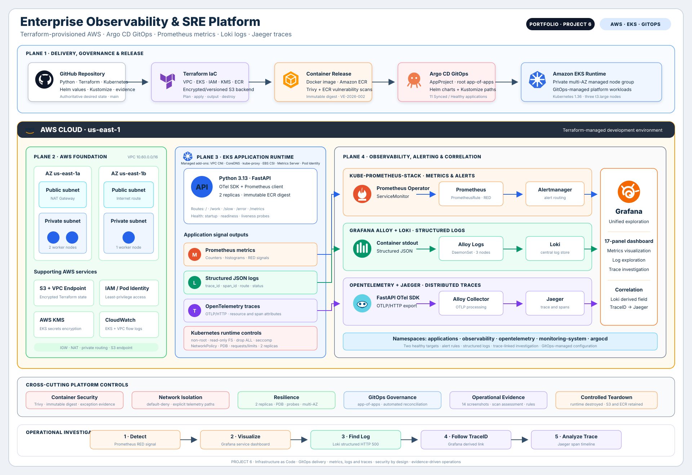

---

## AWS Infrastructure

Terraform provisions the development environment in `us-east-1`.

### Networking

The networking module creates:

* VPC CIDR `10.60.0.0/16`
* Two public subnets
* Two private subnets
* Availability Zones `us-east-1a` and `us-east-1b`
* Internet Gateway
* NAT Gateway
* Dedicated public and private route tables
* S3 Gateway VPC endpoint
* VPC Flow Logs
* CloudWatch log group for flow logs
* IAM role and policy for VPC Flow Logs

EKS worker nodes run in private subnets. The NAT Gateway provides controlled outbound access while the S3 Gateway endpoint keeps S3 traffic on the AWS network.

### Amazon EKS

The EKS module creates:

* EKS 1.36 control plane
* Managed system node group
* Three desired ON_DEMAND `t3.large` nodes
* Minimum node count of two
* Maximum node count of four
* EKS control-plane CloudWatch logging
* Customer-managed KMS key for Kubernetes secrets
* EKS administrator access entry
* EKS access-policy association

Managed add-ons include:

* Amazon VPC CNI
* CoreDNS
* kube-proxy
* Amazon EBS CSI driver
* EKS Pod Identity Agent
* Metrics Server

### IAM and Workload Identity

The platform provisions dedicated IAM roles for:

* EKS control plane
* EKS worker nodes
* Amazon VPC CNI
* Amazon EBS CSI driver

VPC CNI and EBS CSI use EKS Pod Identity rather than long-lived AWS credentials inside Kubernetes.

### Amazon ECR

The demonstration application is published to:

```text
enterprise-observability/observability-demo
```

The repository uses:

* Immutable image tags
* Scan-on-push
* AES-256 encryption
* Lifecycle management
* Digest-pinned Kubernetes deployment

The governed release is deployed using an immutable reference:

```text
sha256:06cfe350458da90bd26cd319ed212d7cd222b17942a9a14e7f63ab87748f246b
```

---

## Technology Stack

| Area                   | Technology                                          |
| ---------------------- | --------------------------------------------------- |
| Cloud                  | AWS                                                 |
| Infrastructure as Code | Terraform                                           |
| Kubernetes             | Amazon EKS 1.36                                     |
| Container registry     | Amazon ECR                                          |
| GitOps                 | Argo CD                                             |
| Kubernetes packaging   | Helm and Kustomize                                  |
| Application            | Python, FastAPI and Uvicorn                         |
| Instrumentation        | OpenTelemetry                                       |
| Metrics                | Prometheus                                          |
| Alerting               | PrometheusRule and Alertmanager                     |
| Visualization          | Grafana                                             |
| Logs                   | Loki                                                |
| Collection             | Grafana Alloy                                       |
| Distributed tracing    | Jaeger                                              |
| Image security         | Trivy and ECR scanning                              |
| Network security       | Kubernetes NetworkPolicy                            |
| Evidence               | Version-controlled screenshots and JSON assessments |

### Pinned Platform Dependencies

| Component             | Helm chart version |
| --------------------- | -----------------: |
| Argo CD               |           `10.4.0` |
| kube-prometheus-stack |           `88.5.4` |
| Loki                  |            `7.3.0` |
| Grafana Alloy         |           `1.12.1` |
| Jaeger                |           `4.12.0` |

Dependency metadata is maintained in [`helm/chart-versions.yaml`](helm/chart-versions.yaml).

---

## GitOps Architecture

Argo CD uses an app-of-apps model.

The `platform-root` Application reconciles ten child Applications:

| Application                     | Responsibility                                  | Namespace       |
| ------------------------------- | ----------------------------------------------- | --------------- |
| `platform-baseline`             | Namespaces, quotas, limits and storage baseline | `applications`  |
| `network-isolation`             | Default-deny and allow-list NetworkPolicies     | `applications`  |
| `kube-prometheus-stack`         | Prometheus, Alertmanager and Grafana            | `observability` |
| `loki`                          | Log storage and Loki gateway                    | `observability` |
| `alloy-logs`                    | Node-level Kubernetes log collection            | `opentelemetry` |
| `alloy-collector`               | OTLP telemetry collection                       | `opentelemetry` |
| `jaeger`                        | Trace storage, query API and UI                 | `opentelemetry` |
| `observability-demo`            | FastAPI demonstration workload                  | `applications`  |
| `observability-demo-monitoring` | ServiceMonitor and PrometheusRule               | `observability` |
| `observability-demo-dashboard`  | Provisioned Grafana dashboard                   | `observability` |

The Git-backed Applications track the `main` branch. External Helm dependencies use explicitly pinned chart versions.

Argo CD continuously reconciles:

* Kubernetes namespaces
* Resource quotas and limits
* Application Deployment and Service
* PodDisruptionBudget
* Monitoring resources
* Grafana dashboard
* NetworkPolicies
* Prometheus stack
* Loki
* Alloy
* Jaeger

---

## Demonstration Application

The project includes an instrumented FastAPI service under:

```text
applications/observability-demo
```

### Application Routes

| Route       | Purpose                                     |
| ----------- | ------------------------------------------- |
| `/`         | Service identity and normal request traffic |
| `/healthz`  | Startup and liveness health                 |
| `/readyz`   | Readiness health                            |
| `/work`     | Controlled work-throughput generation       |
| `/slow`     | Controlled latency generation               |
| `/error`    | Intentional HTTP 500 generation             |
| `/metrics/` | Prometheus metrics endpoint                 |

### Application Telemetry

The application exports:

* HTTP request count
* HTTP status-code dimensions
* Route dimensions
* Request-duration histogram
* Work-item counter
* OpenTelemetry traces
* Structured JSON request logs
* Trace IDs
* Span IDs
* Service and environment attributes

Controlled requests to `/slow` and `/error` produce visible latency and error-rate signals without destabilizing the platform.

---

## Kubernetes Reliability Controls

The application Deployment runs two replicas and includes:

* Rolling-update strategy
* `maxUnavailable: 0`
* `maxSurge: 1`
* Topology-spread constraints
* Startup probe
* Readiness probe
* Liveness probe
* CPU and memory requests
* CPU and memory limits
* PodDisruptionBudget
* Revision history
* Deployment progress deadline

The two replicas were verified as Running on separate worker nodes with two healthy Service endpoints.

---

## Container and Workload Security

The application workload enforces:

```yaml
runAsNonRoot: true
runAsUser: 10001
runAsGroup: 10001
allowPrivilegeEscalation: false
readOnlyRootFilesystem: true
seccompProfile:
  type: RuntimeDefault
capabilities:
  drop:
    - ALL
automountServiceAccountToken: false
```

Additional controls include:

* Digest-pinned ECR image
* Immutable ECR tags
* Non-root image user
* Removed runtime package-management tooling
* Resource requests and limits
* No service-account token mounted
* Trivy vulnerability scanning
* Trivy embedded-secret scanning
* ECR image scanning
* Documented vulnerability-release policy
* Time-bounded development exception
* Production promotion explicitly denied by the exception

The current governed image contains no HIGH or CRITICAL finding with a vendor-provided fix available and no embedded secret.

Remaining upstream findings are documented under:

* [`VE-2026-002`](docs/security/vulnerability-exceptions/VE-2026-002-observability-demo-unfixed-base-image.md)
* [Current vulnerability assessment](docs/security/evidence/observability-demo-83abb0f-vulnerability-assessment.json)
* [Container image release policy](docs/security/container-image-release-policy.md)

---

## Network Isolation

Default-deny NetworkPolicies are applied in:

* `applications`
* `monitoring-system`
* `observability`
* `opentelemetry`

Explicit policies allow only required traffic, including:

* DNS egress
* Prometheus application scraping
* Prometheus node-exporter scraping
* Prometheus CoreDNS scraping
* Prometheus Alloy metrics scraping
* Prometheus Jaeger metrics scraping
* Application OTLP egress
* Alloy OTLP ingress
* Alloy-to-Jaeger OTLP traffic
* Alloy log forwarding to Loki
* Grafana queries to Jaeger
* Required Kubernetes API access
* Internal observability traffic
* Prometheus Operator webhook traffic

NetworkPolicy design is documented in [`kubernetes/network-policies/README.md`](kubernetes/network-policies/README.md).

---

## Metrics and Alerting

Prometheus discovers the application through a dedicated `ServiceMonitor`.

Two application replicas were successfully scraped from:

```text
/metrics/
```

The application `PrometheusRule` defines:

| Rule                              | Severity | Purpose                                               |
| --------------------------------- | -------- | ----------------------------------------------------- |
| `ObservabilityDemoTargetDown`     | Critical | Detect absence or loss of healthy application targets |
| `ObservabilityDemoHighErrorRate`  | Warning  | Detect HTTP 5xx ratio above five percent              |
| `ObservabilityDemoHighP95Latency` | Warning  | Detect p95 request latency above one second           |

The live Prometheus rule interface verified that all three rules were loaded and evaluating successfully.

---

## Grafana Dashboard

The dashboard is provisioned from Git using a labeled Kubernetes ConfigMap.

Dashboard identity:

```text
Title: Observability Demo Service Overview
UID:   observability-demo-overview
```

The dashboard contains 17 panels organized into four sections.

### Service Health

* Healthy Targets
* Available Replicas
* Request Rate
* Error Rate
* p95 Latency
* Work Throughput

### RED Metrics

* Requests by Route
* Requests by HTTP Status
* Request Latency Percentiles
* Error Percentage

### Kubernetes Resources

* Container CPU Usage
* Container Memory Working Set

### Structured Logs and Trace Correlation

* Application Logs
* Trace-linked log navigation

Controlled demonstration traffic produced:

* Visible request-rate increases
* HTTP 500 activity
* Error percentage above eight percent
* p95 latency above 400 milliseconds
* p99 latency above 480 milliseconds

---

## Structured Logging

The application emits structured JSON logs to standard output.

Grafana Alloy runs as a DaemonSet and forwards Kubernetes container logs to Loki.

A request log can contain:

```json
{
  "level": "INFO",
  "service": "observability-demo",
  "environment": "development",
  "event": "http_request_completed",
  "http_method": "GET",
  "http_route": "/error",
  "http_status_code": 500,
  "duration_seconds": 0.002936,
  "trace_id": "481609dbd768dd56aeea15dd3e71f155",
  "span_id": "e37e41ebda7b4a65"
}
```

This structure makes logs searchable by:

* Namespace
* Service
* Pod
* Container
* Environment
* Log level
* HTTP route
* HTTP status
* Trace ID

---

## Distributed Tracing

FastAPI is instrumented with OpenTelemetry.

The trace path is:

```text
FastAPI
   |
   | OTLP/HTTP
   v
Grafana Alloy collector
   |
   v
Jaeger
```

Jaeger verified an intentional `GET /error` request with:

* HTTP status `500`
* OpenTelemetry error status
* One service
* Trace depth of two
* Four spans
* Request and response span timing

---

## Log-to-Trace Correlation

Grafana configures a derived field on the Loki datasource.

The derived field:

1. Extracts a 32-character hexadecimal `trace_id` from the JSON log.
2. Associates the value with the Jaeger datasource.
3. Displays a clickable `TraceID`/Jaeger link in Grafana Explore.
4. Opens the matching Jaeger trace.

The evidence verifies that this Loki trace ID:

```text
481609dbd768dd56aeea15dd3e71f155
```

resolved to the exact Jaeger trace containing four spans for `GET /error`.

This workflow demonstrates how an engineer can move from a failed request log directly to its distributed trace.

---

## Operational Evidence

The following evidence was captured from the rebuilt live environment.

### 1. Terraform Plan

The development plan verified the expected infrastructure changes before deployment.

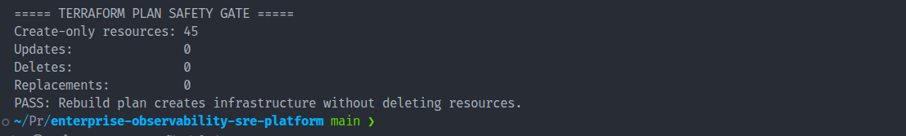

### 2. Terraform Apply and Outputs

Terraform completed the AWS deployment and returned the EKS, networking, IAM, add-on and ECR outputs.

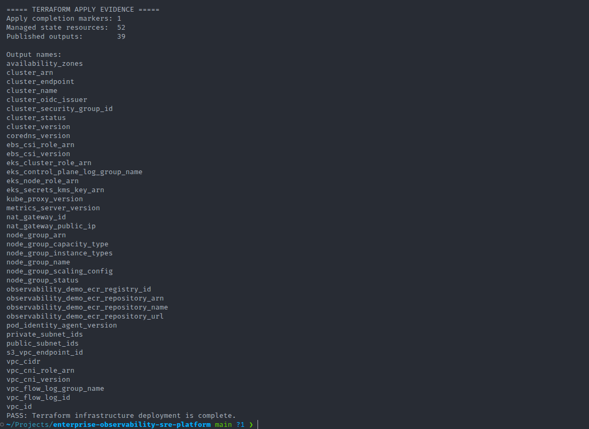

### 3. Amazon EKS Cluster

The EKS control plane and managed node group were Active, with three Ready worker nodes.

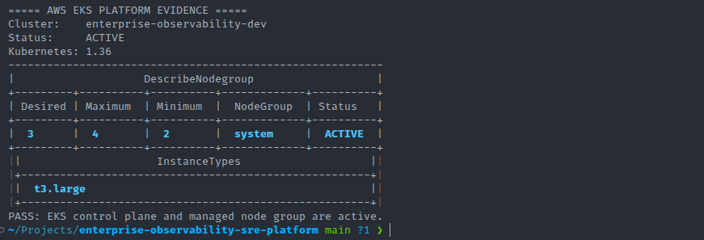

### 4. Kubernetes Runtime

The Kubernetes evidence verifies Ready nodes, two application replicas, healthy endpoints and the immutable application image.

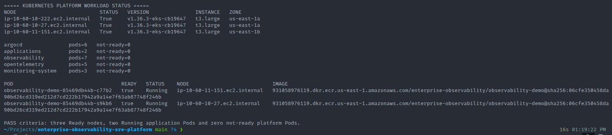

### 5. Argo CD Applications

The Argo CD inventory shows the root and all ten child Applications Synced and Healthy.

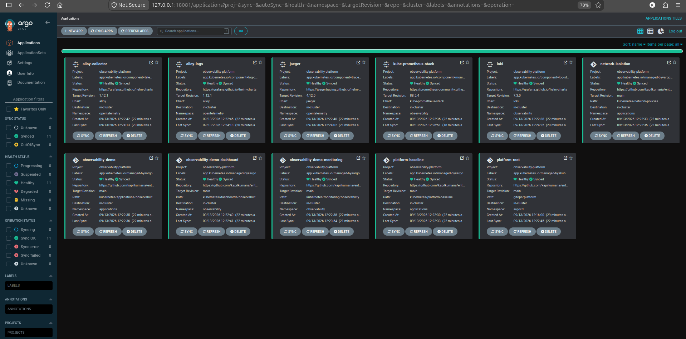

### 6. Argo CD Resource Tree

The application resource tree verifies the GitOps-managed Deployment, Service, ReplicaSet, Pods and PodDisruptionBudget.

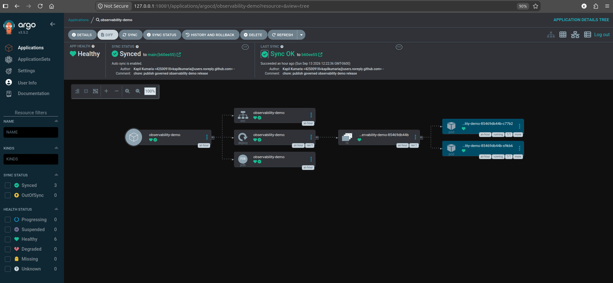

### 7. Prometheus Targets

Prometheus successfully scraped both application Pod endpoints.

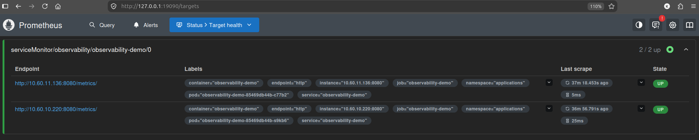

### 8. Prometheus Rules

The application availability, error-rate and p95-latency rules were loaded and healthy.

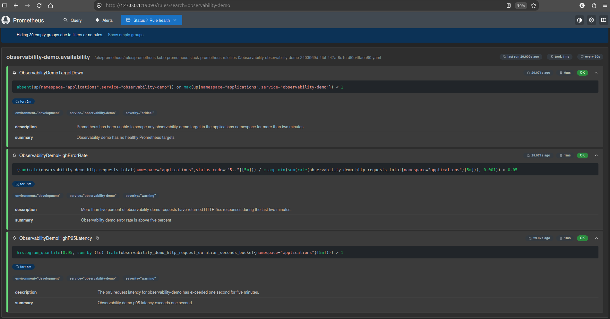

### 9. Grafana Dashboard

The dashboard visualized current service health and historical request, error and latency activity.

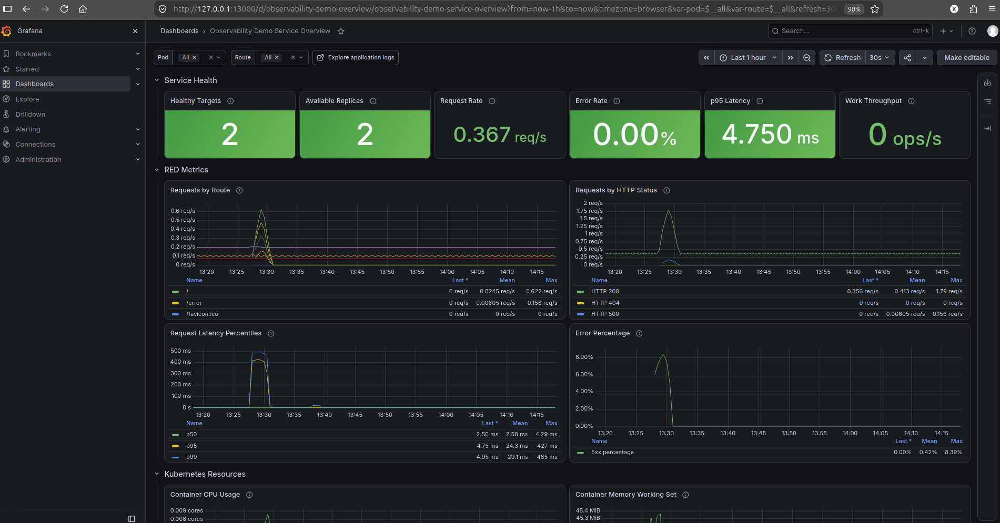

### 10. Loki Structured Logs

Grafana Explore returned structured logs containing HTTP and OpenTelemetry correlation fields.

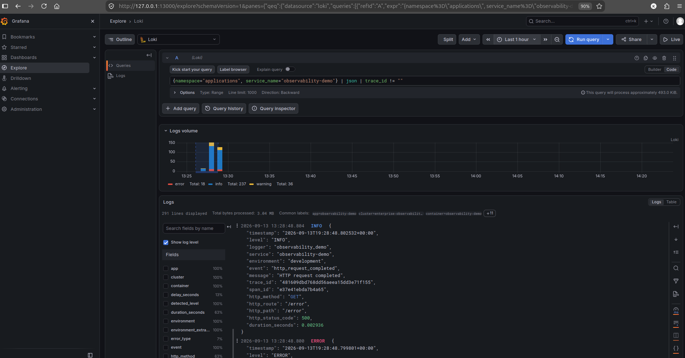

### 11. Jaeger Trace

Jaeger displayed the complete four-span trace for the intentional HTTP 500 request.

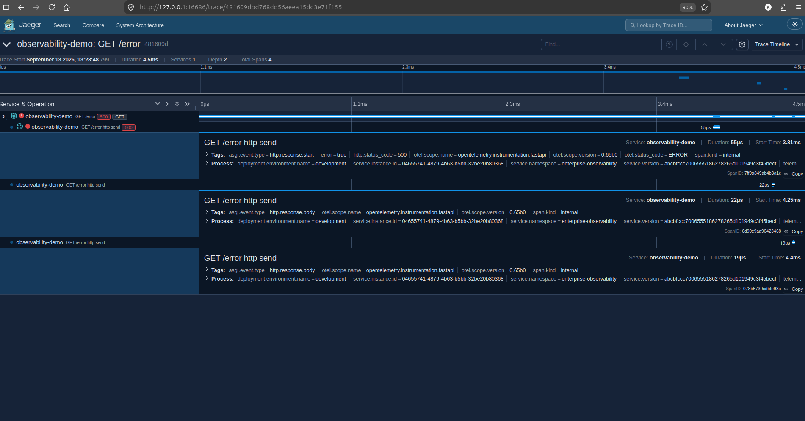

### 12. Grafana Loki-to-Jaeger Correlation

The Loki log exposes a clickable Jaeger derived-field link for the matching trace ID.

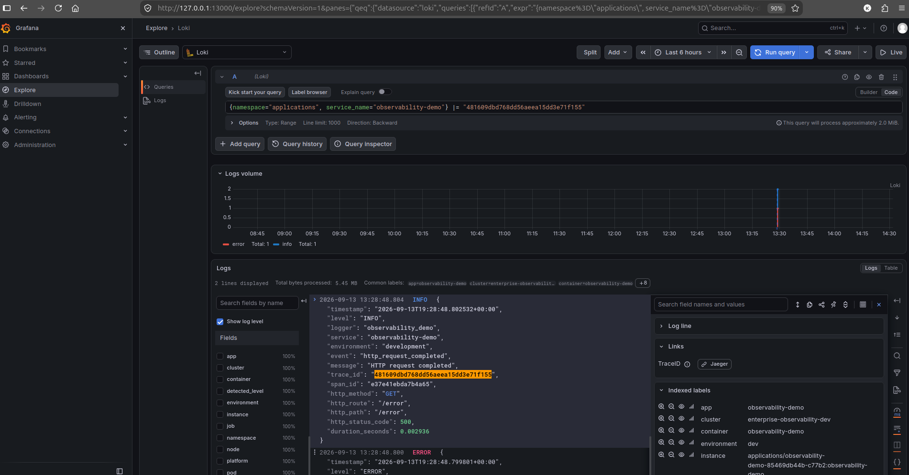

### 13. Kubernetes Security Controls

The live Deployment verifies non-root execution, read-only storage, dropped capabilities, resource controls, NetworkPolicies and disruption protection.

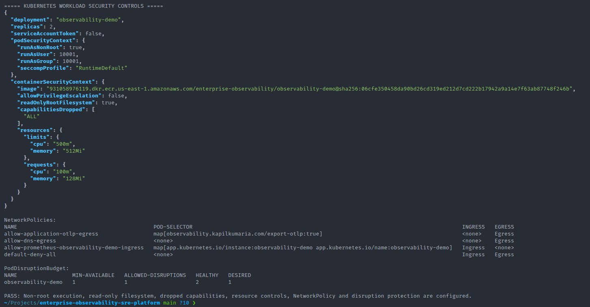

### 14. Governed Container Release

The release gate verifies application tests, runtime metadata, zero fixable HIGH or CRITICAL findings, zero embedded secrets and the approved development-only exception.

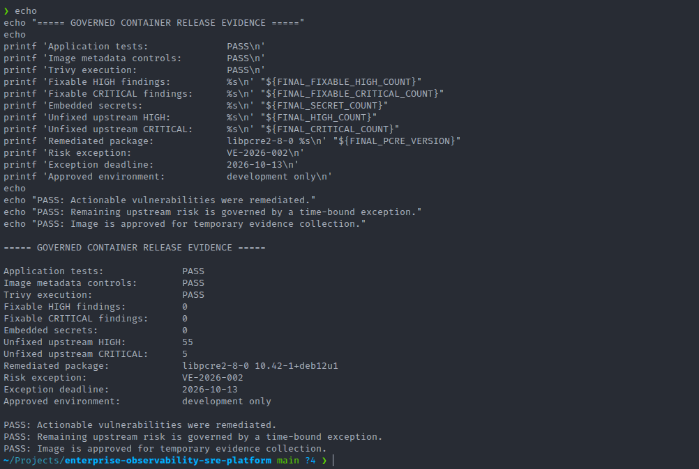

### 15. Controlled AWS Teardown

The final audit verifies that the charge-heavy runtime was destroyed while the Terraform backend and governed ECR release were intentionally retained.

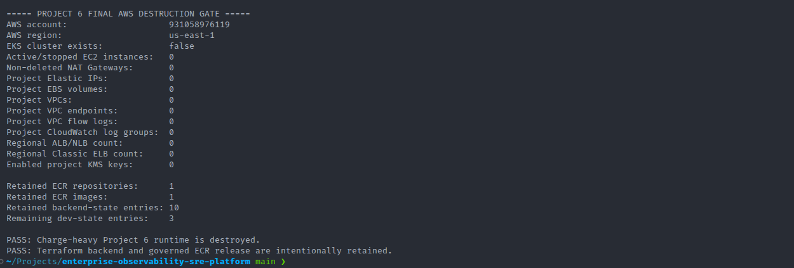

---

## Rebuild Workflow

The validated rebuild followed this order:

1. Verify the local toolchain.
2. Confirm a clean and synchronized Git branch.
3. Initialize the retained Terraform backend.
4. Run Terraform formatting and validation.
5. Create and review the Terraform plan.
6. Apply the AWS development infrastructure.
7. Update kubeconfig.
8. Wait for all EKS nodes to become Ready.
9. Run FastAPI application tests.
10. Build the Linux AMD64 container image.
11. Inspect architecture, runtime user and package metadata.
12. Scan the image with Trivy.
13. Remediate all actionable HIGH and CRITICAL findings.
14. Document remaining upstream findings.
15. Push the governed image to ECR.
16. Update the Deployment to the immutable ECR digest.
17. Install Argo CD using the pinned Helm chart.
18. Configure private Git repository authentication.
19. Apply the AppProject and root Application.
20. Wait for all eleven Argo CD Applications.
21. Validate Kubernetes workloads and network controls.
22. Generate controlled application traffic.
23. Validate Prometheus metrics and rules.
24. Validate the Grafana dashboard.
25. Validate Loki structured logs.
26. Validate the matching Jaeger trace.
27. Validate Grafana Loki-to-Jaeger correlation.
28. Capture and commit operational evidence.
29. Destroy the charge-heavy AWS runtime.
30. Retain the Terraform backend and governed ECR release.

---

## Repository Structure

```text
.
├── applications/
│   └── observability-demo/        # FastAPI service, tests and Dockerfile
├── argocd/
│   ├── applications/              # Root Application
│   ├── bootstrap/                 # Argo CD Helm configuration
│   └── projects/                  # AppProject boundaries
├── docs/
│   ├── adr/                       # Architecture decisions
│   ├── incidents/                 # Controlled incident records
│   ├── runbooks/                  # Operational procedures
│   ├── screenshots/               # Live implementation evidence
│   └── security/                  # Policies, assessments and exceptions
├── gitops/
│   └── platform/                  # Child Argo CD Applications
├── helm/                          # Pinned dependency versions and values
├── kubernetes/
│   ├── applications/              # Application manifests
│   ├── dashboards/                # Grafana dashboard
│   ├── monitoring/                # ServiceMonitor and PrometheusRule
│   ├── network-policies/          # Default-deny and allow policies
│   └── platform-baseline/         # Namespaces, quotas, limits and storage
└── terraform/
    ├── bootstrap/                 # Remote-state S3 backend
    ├── environments/dev/          # Development composition
    └── modules/
        ├── ecr/
        ├── eks/
        ├── iam/
        └── networking/
```

---

## Documentation

Detailed documentation is maintained under `docs/`:

* [Architecture](docs/architecture.md)
* [Implementation Guide](docs/implementation.md)
* [Security Architecture](docs/security.md)
* [Operations Guide](docs/operations.md)
* [Troubleshooting Guide](docs/troubleshooting.md)
* [Platform Validation Runbook](docs/runbooks/platform-validation.md)
* [Telemetry Investigation Runbook](docs/runbooks/telemetry-investigation.md)
* [Controlled High-Error-Rate Incident](docs/incidents/observability-demo-high-error-rate.md)
* [Amazon EKS Architecture Decision](docs/adr/0001-use-amazon-eks.md)
* [Application Documentation](applications/observability-demo/README.md)
* [Helm Dependency Documentation](helm/README.md)
* [NetworkPolicy Documentation](kubernetes/network-policies/README.md)
* [Container Image Release Policy](docs/security/container-image-release-policy.md)

---

## Security Evidence

Current governed-release evidence:

* [Vulnerability assessment](docs/security/evidence/observability-demo-83abb0f-vulnerability-assessment.json)
* [Development-only exception VE-2026-002](docs/security/vulnerability-exceptions/VE-2026-002-observability-demo-unfixed-base-image.md)
* [Container image release policy](docs/security/container-image-release-policy.md)

Historical evidence is retained to demonstrate remediation and release-governance progression.

---

## Cost Management and Teardown

The live environment provisions chargeable AWS resources, especially:

* Amazon EKS worker nodes
* NAT Gateway
* EBS storage
* CloudWatch Logs
* Customer-managed KMS key
* Amazon ECR storage
* S3 backend storage

After evidence collection, the charge-heavy runtime was destroyed.

Intentionally retained resources:

* Versioned Terraform backend S3 bucket
* Immutable ECR repository
* One governed application image
* Terraform state entries managing the retained resources

Retaining these resources allows the platform to be reconstructed while keeping ongoing storage cost minimal.

---

## Current Scope and Future Improvements

The completed implementation proves the core observability and GitOps workflow.

Potential production-oriented extensions include:

* Formal application SLIs and SLOs
* Error-budget reporting
* Multi-window burn-rate alerts
* Blackbox synthetic monitoring
* k6 performance and reliability suites
* GitHub Actions validation workflows
* Policy-as-code admission controls
* Alertmanager notification integrations
* Highly available Loki and Jaeger storage
* Long-term S3 telemetry retention
* Multi-account AWS deployment
* Multi-cluster observability
* Multi-region disaster recovery
* External ingress with TLS and authentication
* Managed secrets integration
* Automated dependency and vulnerability updates

These items are future enhancements and are not represented as completed functionality.

---

## Engineering Decisions Demonstrated

This project demonstrates several senior-level engineering decisions:

* Terraform manages cloud infrastructure while Argo CD manages Kubernetes workloads.
* Git is the authoritative source of Kubernetes desired state.
* External Helm charts are version-pinned.
* Application images are deployed by digest rather than mutable tags.
* Telemetry uses OpenTelemetry rather than vendor-specific instrumentation.
* Metrics, logs and traces are correlated instead of operated as isolated systems.
* Network communication follows default-deny and explicit-allow principles.
* Actionable vulnerabilities block release.
* Unfixed upstream findings require a documented and time-bounded exception.
* Evidence is captured before infrastructure destruction.
* Expensive runtime resources are separated from retained state and release artifacts.
* Future capabilities are clearly separated from verified implementation.

---

## Project Status

**Status: Completed**

Verified completion includes:

* AWS infrastructure deployment
* EKS cluster validation
* Governed container release
* Argo CD reconciliation
* Prometheus target and rule validation
* Grafana dashboard validation
* Loki structured-log validation
* Jaeger trace validation
* Log-to-trace correlation
* Kubernetes security validation
* Operational evidence publication
* Runtime infrastructure destruction
* Backend and ECR retention

---

## Author

**Kapil Kumaria**
Senior DevOps and Cloud Platform Engineer
Calgary, Alberta, Canada

Portfolio: https://kapilkumaria.com
